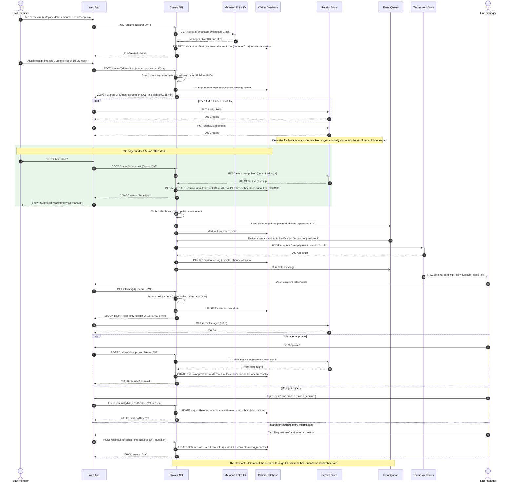
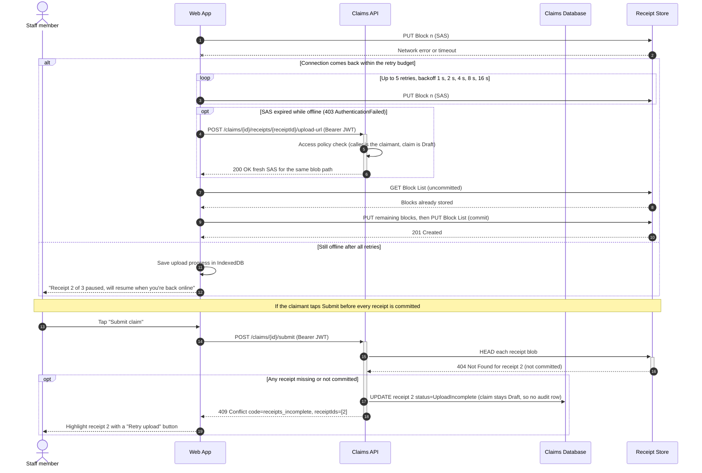
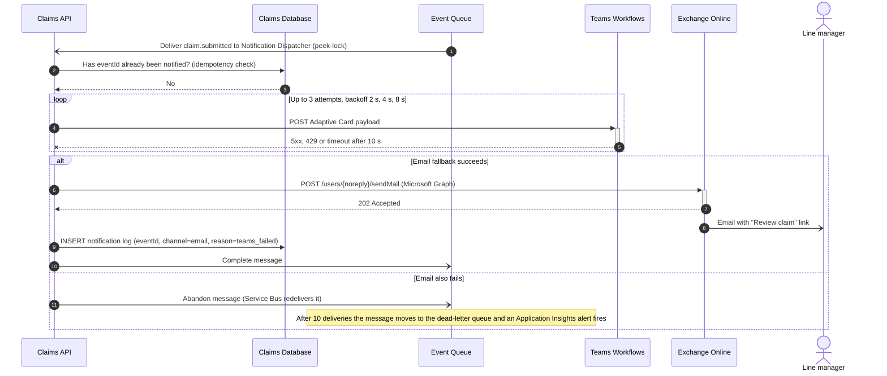

# Sequence — Submit and Approve a Claim

Lifeline names are exactly the container and external-system names used in the
[Container diagram](container-diagram.png). Background components inside the Claims API
(Outbox Publisher, Notification Dispatcher) appear as self-calls on the `Claims API` lifeline.

**Notation**

| Arrow | Meaning |
|-------|---------|
| `->>` solid line, filled head | Synchronous call that waits for a response |
| `-->>` dashed line | Response to an earlier synchronous call |
| `-)` solid line, open head | Asynchronous message (no caller waiting) |
| Arrow back to the same lifeline | Self-call / background work inside that container |

**Precondition:** the user is already signed in through Microsoft Entra ID (MSAL.js, auth code + PKCE),
so every call from the Web App to the Claims API carries a Bearer JWT.

## Happy path

Receipts upload **while the claimant fills in the form**, before they tap Submit.
That's why the 1.5 s p95 target (shaded) covers only the submit call, not up to 50 MB of uploads.

## Error path 1 — receipt upload is interrupted (intermittent connectivity)

The claim already exists as a Draft. Nothing is lost: block blobs keep uploaded-but-uncommitted
blocks for 7 days, so the Web App resumes from the first missing block instead of starting again.

## Error path 2 — Teams notification fails, email fallback

Teams Workflows returns `202 Accepted` when it receives the request. A failure **inside** the
workflow after that point isn't visible to us. See "Known risks" in the design pack (risk R2).

