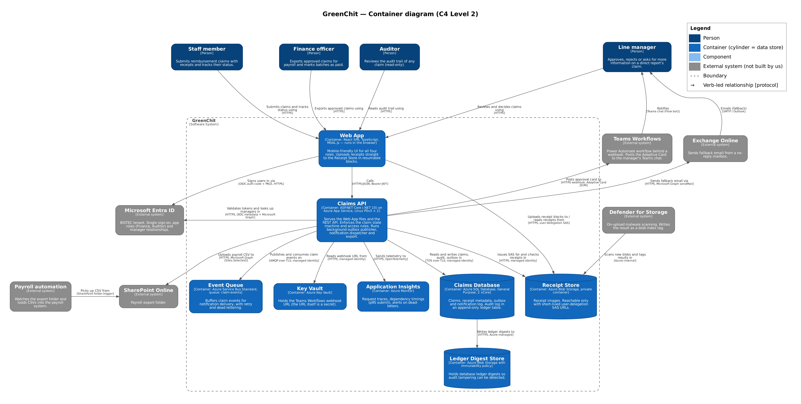
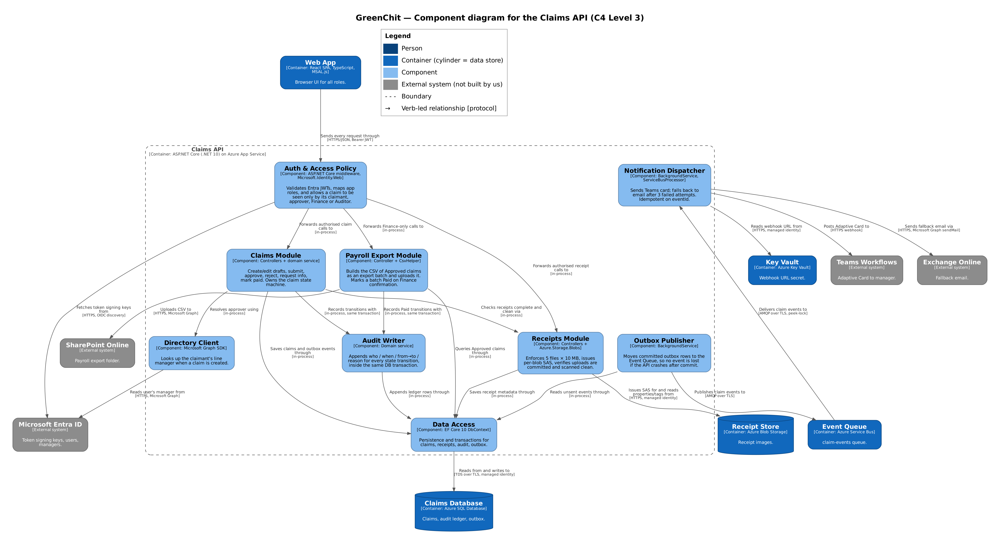

# GreenChit — Architecture Design Pack

> **Assumptions** this design rests on are listed at the end (A1–A7). Several are things the brief
> doesn't say. Please challenge them in review.

## 1. System Context (one-paragraph recap of Day 1-style context)

GreenChit is BISTEC's internal expense-reimbursement system. **Staff members** submit claims
(category, date, amount in LKR, description, and up to 5 receipt images) and track each claim through
**Draft → Submitted → Approved / Rejected → Paid**. When a manager asks for more information, the
claim goes back to Draft with their question attached. **Line managers** are notified in Microsoft
Teams, with email as a fallback, and approve, reject or request information. **Finance officers**
export approved claims as a CSV into a SharePoint folder, where the existing **payroll automation**
picks them up. Finance then marks the export batch as Paid. **Auditors** can read the tamper-evident
history of every claim, which is kept for 7 years. GreenChit depends on five external systems:
**Microsoft Entra ID** (single sign-on, roles and the manager relationship), **Teams Workflows** and
**Exchange Online** (notifications), **SharePoint Online** (the payroll hand-off) and **Defender for
Storage** (malware scanning of receipts). Only the claimant, their approver, Finance and the Auditor
can see a given claim.

## 2. Containers (C4 Level 2)

Editable source: `diagrams/container-diagram.drawio`. Generated source: `diagrams/src/container-diagram.dot`.

**Containers inside GreenChit**

| Container | Technology | Responsibility |
|-----------|------------|----------------|
| Web App | React SPA, TypeScript, MSAL.js; runs in the browser (static files served by the Claims API) | Mobile-friendly UI for all four roles. Signs users in with Entra ID (auth code + PKCE). Uploads receipts straight to the Receipt Store in resumable 1 MiB blocks. |
| Claims API | ASP.NET Core (.NET 10 LTS) on Azure App Service, Linux, Premium v3 P0v3 × 2, staging slot (ADR-0002) | REST API and the claim state machine. Enforces who can see and do what. Issues SAS URLs. Runs background workers: Outbox Publisher, Notification Dispatcher, abandoned-draft clean-up. |
| Claims Database | Azure SQL Database, General Purpose, 2 vCore provisioned, Entra-only auth (ADR-0003) | Claims, receipt metadata, export batches, outbox and notification log. Audit log in an append-only **ledger** table. |
| Receipt Store | Azure Blob Storage, private container, shared-key access disabled (ADR-0004) | Receipt images, reachable only through short-lived single-blob user-delegation SAS. Scanned on upload. |
| Event Queue | Azure Service Bus Standard, queue `claim-events` | Decouples "the claim changed" from "someone was notified". Redelivers on failure and dead-letters after 10 attempts. |
| Ledger Digest Store | Azure Blob Storage with a time-based immutability policy | Holds the database ledger digests, so any tampering with the audit log can be detected. |
| Key Vault | Azure Key Vault | Holds the Teams Workflows webhook URL. Anyone with that URL can post, so it's treated as a secret. |
| Application Insights | Azure Monitor (OpenTelemetry) | Traces and dependency timings (submit p95), availability tests, alerts on dead-letters and scan backlog. |

**External systems (not built by us)**

| External system | What GreenChit uses it for |
|-----------------|----------------------------|
| Microsoft Entra ID | SSO for the Web App, token validation for the API, app roles `Finance` and `Auditor`, and the claimant's manager (Graph `GET /users/{id}/manager`). |
| Teams Workflows | Power Automate workflow behind a webhook URL. Posts the Adaptive Card to the manager as a Flow bot chat. Microsoft retired the old Office 365 "Incoming Webhook" connectors in Teams in May 2026, so Workflows is the supported route. |
| Exchange Online | Fallback email from a no-reply mailbox, sent with Graph `sendMail`. The app's mail permission is limited to that one mailbox. |
| SharePoint Online | Payroll export folder. GreenChit writes with Graph using `Sites.Selected` (this one site only). |
| Payroll automation | Existing BISTEC automation that watches the folder and loads the CSV. |
| Defender for Storage | On-upload malware scanning. The result is written as the blob index tag `Malware Scanning scan result`. |

## 3. Components (C4 Level 3) for the API service

Editable source: `diagrams/component-diagram.drawio`. Generated source: `diagrams/src/component-diagram.dot`.
Same notation as Level 2: same colours, same shapes and same "verb + [protocol]" arrow labels. Containers
outside the Claims API keep their Level 2 names exactly.

| Component | Technology | Responsibility |
|-----------|------------|----------------|
| Auth & Access Policy | ASP.NET Core middleware, Microsoft.Identity.Web | Validates Entra JWTs and maps app roles. Applies the claim visibility rule on every request: the **claimant** sees their own claims, the **approver** sees claims where they are `approverId`, the **Finance** role sees all claims, and the **Auditor** role has read-only access to all claims and their audit trail. |
| Claims Module | Controllers + domain service | Create and edit drafts, submit, approve, reject (reason required), request info (back to Draft with a question), mark paid. **Owns the state machine.** An illegal transition returns 409. |
| Receipts Module | Controllers + Azure.Storage.Blobs | Enforces 5 files × 10 MB and JPEG/PNG. Issues per-blob SAS (upload 15 min, view 5 min, never the tag-write permission). Checks blobs are committed and reads the scan result before approval. |
| Payroll Export Module | Controller + CsvHelper | Finance-only. Puts all Approved, not-yet-exported claims into an **export batch** (so a claim can't be exported twice), writes the CSV and uploads it to SharePoint. Marks the batch Paid when Finance confirms. |
| Directory Client | Microsoft Graph SDK | Looks up the claimant's manager when a claim is created and stores it on the claim as `approverId`. |
| Audit Writer | Domain service | Appends `claimId, fromStatus, toStatus, actorObjectId, occurredAtUtc, reason` for **every** transition, inside the same transaction as the change itself. |
| Data Access | EF Core 10 DbContext | Persistence, migrations and transactions. The only component that talks to the Claims Database. |
| Outbox Publisher | `BackgroundService` | Reads committed outbox rows (`UPDLOCK, READPAST`, so two instances don't collide), sends them to the Event Queue and marks them sent. An event is never lost even if the API crashes right after commit. |
| Notification Dispatcher | `BackgroundService`, `ServiceBusProcessor` | Consumes claim events and posts the Adaptive Card to Teams Workflows. After 3 failed attempts it sends email instead. Skips events it has already handled (idempotent on `eventId`), because Service Bus can deliver the same message more than once. |

## 4. Reading order — how a reviewer should walk through the diagrams

1. **Section 1 (Context)**, to learn the four roles and five external systems. Every later diagram uses exactly these names.
2. **Container diagram, top to bottom.** Start with the four people at the top and follow them into the **Web App**, then down to the **Claims API**, which everything else hangs off. Then read the data stores along the bottom (Claims Database, Receipt Store, Event Queue, Ledger Digest Store), and finally the grey external systems. Two arrows to notice: **Web App → Receipt Store** (receipts bypass the API, see ADR-0004) and **Claims Database → Ledger Digest Store** (tamper evidence, see ADR-0003).
3. **Component diagram, along the request path**, which zooms into the Claims API box. Follow Web App → **Auth & Access Policy** → Claims / Receipts / Payroll Export → **Audit Writer** → **Data Access** → Claims Database. Then follow the **background path** on the right: Outbox Publisher → Event Queue → Notification Dispatcher → Teams Workflows / Exchange Online.
4. **Sequence diagram, happy path** (`diagrams/sequence-submit-approve.md`). This is the component path from step 3 in time order. Check the shaded box: it's exactly what the 1.5 s p95 covers. Then look at the three outcomes in the `alt` fragment (approve / reject / request info).
5. **Sequence diagram, error paths 1 and 2.** Interrupted upload (the NFR on intermittent connectivity), then the Teams failure with email fallback.
6. **ADRs in number order** (`adrs/0001` to `0004`). Each one explains why a box from step 2 looks the way it does. Read the "Harder (uncomfortable)" bullet in each first.
7. **Trade-offs** (`mohamed-rizath-day4-trade-offs-and-review.md`). Why App Service beat Container Apps, and which weighting would reverse that.

## Known risks (for the design review)

| # | Risk | Where it's addressed |
|---|------|----------------------|
| R1 | Background workers share the request process, so a slow webhook or a leak can hurt submit p95. | ADR-0002, accepted with mitigations and a revisit trigger. |
| R2 | Teams Workflows returns 202 on receipt, so a failure *inside* the workflow is invisible to us. The workflow is also owned by whoever created it: if that account is disabled, notifications stop silently. | Mitigation: create the workflow under a dedicated service account with a co-owner, and send a daily synthetic notification checked by an Application Insights availability test. **Not yet in an ADR. Candidate for ADR-0005.** |
| R3 | **The line manager is absent or changes.** `approverId` is captured when the claim is created and v1 has no delegation, so a claim can sit in Submitted indefinitely. | Not solved in v1. Proposal: a Finance "reassign approver" action and a daily report of claims Submitted for more than 5 business days. |
| R4 | Malware scanning is asynchronous, so the manager may be notified before the scan finishes. | ADR-0004, accepted. Approval is blocked until the result is `No threats found`. |
| R5 | Audit rows can never be deleted, which conflicts with any future data-erasure request. | ADR-0003, needs Legal sign-off before go-live. |
| R6 | 99.9% availability: multiplying the published SLAs of the services on the submit path (App Service, SQL, Blob, Entra ID) gives slightly *less* than 99.9%. | Real-world uptime is usually well above SLA, and our target covers business hours only. Mitigation: zone-redundant SQL and ZRS storage, measured by an availability test. Flagged so a reviewer doesn't find it first. |
| R7 | The payroll CSV column layout isn't in the brief. | Open question for the payroll owner. The export batch design prevents GreenChit from exporting the same claim twice, but can't stop payroll processing one file twice. |

## Assumptions

| # | Assumption | Why it matters |
|---|------------|----------------|
| A1 | Team of about 10, strong in .NET/C#, React and SQL, little container or IaC experience. | Drives ADR-0002 and ADR-0003. If wrong, Container Apps and Cosmos DB become more competitive. |
| A2 | No on-call outside 08:00–19:00 SLST. | Favours fewer moving parts. Deployments happen outside business hours or by slot swap. |
| A3 | Fewer than 50 submissions per peak hour, a few thousand claims a year. | Makes scaling a low-weight attribute. |
| A4 | Receipts are JPEG or PNG ("receipt images" in the brief). | PDF e-receipts would be a small change to the Receipts Module. |
| A5 | Receipts are kept 7 years, like the audit log. | Drives the lifecycle rule in ADR-0004. To confirm with Finance. |
| A6 | Paid is set by Finance confirming an export batch. Payroll has no callback. | If payroll can call back, Paid could be set automatically. |
| A7 | The approver is the claimant's Entra manager at the time the claim is created. | See risk R3. |
